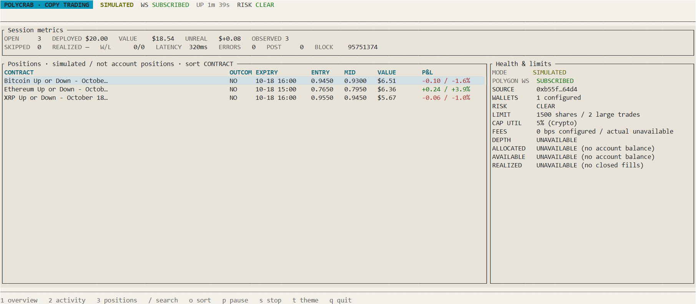
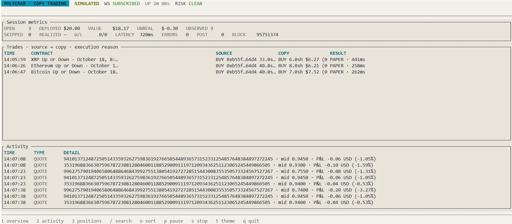

# PolyCrab

PolyCrab is a Rust Polymarket copy-trading toolkit with simulated/live order execution and a terminal dashboard.

## TUI panel

The ratatui/crossterm dashboard surfaces session metrics, positions, health limits, copied trades, and quote activity. These screenshots show the dashboard running in simulated mode:

## Implemented features

- Polygon `OrderFilled` ingestion and Gamma market metadata lookup.
- Slug/category/tag filters, percentage/fixed/adaptive sizing, exposure caps, and a circuit breaker.
- Simulated orders by default, plus EIP-712/L2-authenticated CLOB submission for explicitly enabled live mode.
- Session-local positions with CLOB midpoint TP/SL monitoring.
- ratatui/crossterm operator dashboard and headless Copy Trading mode.

## Documentation

- [Quick start](docs/QUICKSTART.md)
- [Documentation index](docs/README.md)
- [MIT License](LICENSE)
