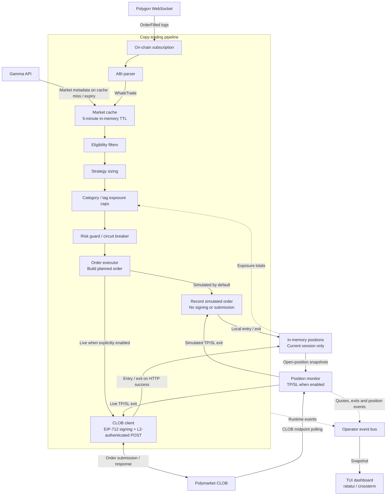

# Architecture

PolyCrab is a single asynchronous Rust process. The current runtime starts the
Copy Trading bot either headlessly or behind the ratatui/crossterm terminal
dashboard.

## Runtime flow

1. [`src/main.rs`](../src/main.rs) parses `--config` and `--credentials`,
   loads [`config.json`](../config.json), and selects TUI or headless mode.
2. [`src/bot/copy_trading.rs`](../src/bot/copy_trading.rs) selects the first
   configured source wallet and subscribes to `OrderFilled` logs for the two
   configured Polymarket exchange contracts.
3. [`src/service/parse.rs`](../src/service/parse.rs) decodes matching logs
   into normalized `WhaleTrade` values.
4. [`src/service/market_cache.rs`](../src/service/market_cache.rs) resolves
   the token through Gamma and keeps market metadata in a five-minute in-memory
   cache.
5. [`src/service/eligibility.rs`](../src/service/eligibility.rs) applies
   closed-market, slug, category, and tag rules.
6. [`src/service/strategy.rs`](../src/service/strategy.rs) calculates the
   copied USD amount using percentage, fixed, or adaptive sizing.
7. [`src/service/position_store.rs`](../src/service/position_store.rs) checks
   category/tag exposure caps, while
   [`src/service/risk_guard.rs`](../src/service/risk_guard.rs) applies the
   large-trade circuit breaker.
8. [`src/service/order_executor.rs`](../src/service/order_executor.rs) builds
   a planned order. It records the order locally in simulated mode or passes
   it to [`src/service/clob.rs`](../src/service/clob.rs) for EIP-712 signing and
   L2-authenticated submission in live mode.
9. [`src/service/position_monitor.rs`](../src/service/position_monitor.rs)
   polls CLOB midpoints and applies configured TP/SL exits to local positions.
10. [`src/operator.rs`](../src/operator.rs) publishes events consumed by
    [`src/ui/mod.rs`](../src/ui/mod.rs), which renders connection state,
    trades, positions, risk state, and session metrics.

## State and boundaries

- Only the first `bot.wallets_to_track` entry is currently active.
- Polymarket is the only supported venue and Copy Trading is the only exposed
  bot.
- Positions, simulated orders, and P&L live in memory for the current session.
- There is no database, account-balance reader, fill/status reconciliation, or
  local HTTP server.
- Source sells are ignored; TP/SL is the configured exit path.
- The configured depth threshold is covered by risk-module tests, but no
  production order-book provider is connected. When a large trade requests a
  book check, the executor logs a warning and continues.
- A successful CLOB HTTP response means submission was accepted by the HTTP
  endpoint; it is not confirmation of an exchange fill.
